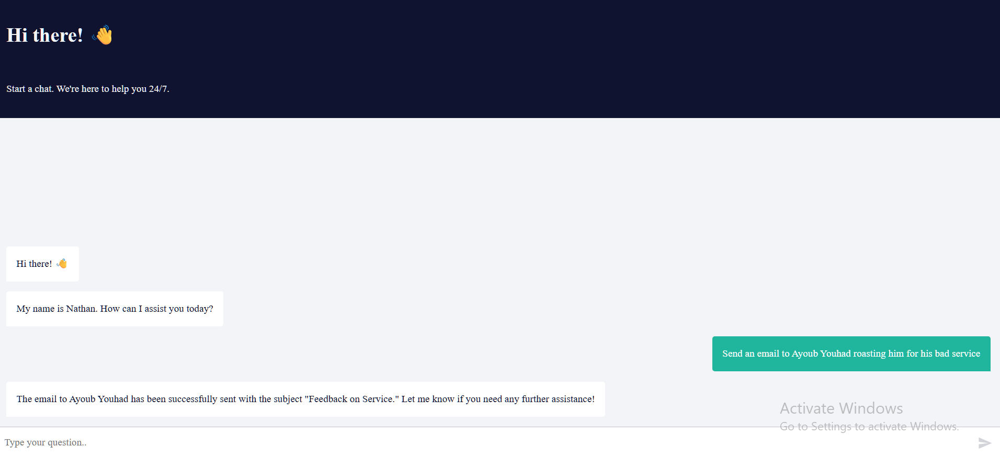

# AI Powered Email Automation

An AI-driven email automation system built as a set of workflow agents. It ingests emails into a **Pinecone** vector database, uses that knowledge base to power an intelligent **Email Agent** that can understand and answer queries, and includes a dedicated **Email Sender Agent** that composes and sends emails automatically.

---

## Table of Contents

- [Overview](#overview)
- [Features](#features)
- [Architecture](#architecture)
- [Repository Structure](#repository-structure)
- [Workflows Explained](#workflows-explained)
- [Prerequisites](#prerequisites)
- [Setup & Installation](#setup--installation)
- [Usage](#usage)
- [Screenshots](#screenshots)
- [Customization](#customization)
- [Troubleshooting](#troubleshooting)
- [Contributing](#contributing)
- [License](#license)

---

## Overview

Managing a busy inbox is repetitive and time-consuming. This project automates it using AI:

1. **Ingest** – Emails are converted to embeddings and stored in Pinecone.
2. **Understand** – An AI agent retrieves relevant email context from Pinecone (RAG – Retrieval-Augmented Generation) to answer questions or draft replies.
3. **Act** – A sender agent composes and delivers emails on your behalf.

## Features

- 📥 Automatic ingestion of emails into a vector database
- 🧠 Semantic search over email history using Pinecone
- 🤖 Conversational AI agent with chat interface for querying your emails
- ✉️ Automated, context-aware email composition and sending
- 🔌 Import-ready workflow JSON files – no coding from scratch
- 🖼️ Screenshots of each workflow for quick reference

## Architecture

```
┌──────────────┐     ┌──────────────────┐     ┌────────────────┐
│  Email Inbox │ ──► │ Emails to Pinecone│ ──► │ Pinecone Vector │
│              │     │   (ingestion)     │     │    Database     │
└──────────────┘     └──────────────────┘     └───────┬────────┘
                                                      │ retrieval
                      ┌──────────────────┐            ▼
        User chat ──► │   Email Agent    │ ◄── context from Pinecone
                      └────────┬─────────┘
                               │ triggers
                               ▼
                      ┌──────────────────┐     ┌──────────────┐
                      │ Email Sender     │ ──► │ Email Sent ✅ │
                      │     Agent        │     └──────────────┘
                      └──────────────────┘
```

## Repository Structure

| File | Description |
|------|-------------|
| `Emails to Pincone.json` | Workflow that reads emails and stores their embeddings in Pinecone |
| `Emails to Pincone.png` | Screenshot of the ingestion workflow |
| `Email Agent Pincone.json` | AI agent workflow that retrieves context from Pinecone and responds to queries |
| `Email Agent Pincone.png` | Screenshot of the email agent workflow |
| `Email Sender Agent.json` | Workflow that drafts and sends emails |
| `Email Sender Agent.png` | Screenshot of the sender agent workflow |
| `Chatpng.png` | Screenshot of the chat interface interacting with the agent |
| `Email Sent.png` | Screenshot showing a successfully sent email |

## Workflows Explained

### 1. Emails to Pinecone
Fetches emails, splits/cleans the content, generates embeddings, and upserts them into a Pinecone index so they become searchable by meaning.

### 2. Email Agent (Pinecone)
An AI agent connected to the Pinecone vector store as a tool. When you ask a question in the chat, it retrieves the most relevant emails and uses an LLM to generate an accurate, context-aware response.

### 3. Email Sender Agent
Takes instructions (e.g., recipient, intent, tone), generates the email content with an LLM, and sends it through your configured email provider.

## Prerequisites

- A workflow automation platform that can import the provided `.json` files (e.g., [n8n](https://n8n.io/))
- A [Pinecone](https://www.pinecone.io/) account and API key
- An LLM / embeddings provider API key (e.g., OpenAI, Google Gemini)
- Email account credentials (Gmail OAuth, SMTP, etc.)

## Setup & Installation

1. **Clone the repository**
   ```bash
   git clone https://github.com/dravyesh/AI_Powered_Email_Automation.git
   cd AI_Powered_Email_Automation
   ```

2. **Create a Pinecone index**
   - Log in to Pinecone and create an index.
   - Make sure the index **dimension matches your embedding model** (e.g., 1536 for OpenAI `text-embedding-3-small`).

3. **Import the workflows**
   - Open your automation platform.
   - Import each JSON file: `Emails to Pincone.json`, `Email Agent Pincone.json`, `Email Sender Agent.json`.

4. **Configure credentials**
   - Pinecone API key and index name
   - LLM / embeddings API key
   - Email account (Gmail / SMTP)

5. **Activate the workflows**

## Usage

1. Run **Emails to Pinecone** to index your emails.
2. Open the chat interface and ask the **Email Agent** something like:
   - *"Summarize the latest emails from my manager."*
   - *"Did anyone send me an invoice last week?"*
3. Instruct the **Email Sender Agent** to write and send an email, e.g.:
   - *"Send a polite follow-up to john@example.com about the project deadline."*

## Screenshots

| Ingestion | Email Agent |
|-----------|-------------|
|  |  |

| Sender Agent | Chat |
|--------------|------|
|  |  |

| Email Sent |
|------------|
|  |

## Customization

- Swap the LLM or embedding model for another provider.
- Change the chunk size and metadata stored in Pinecone.
- Edit the agent's system prompt to change tone, language, or behavior.
- Add filters (sender, date, label) to control which emails get indexed.

## Troubleshooting

- **Pinecone dimension mismatch** – recreate the index with the correct embedding dimension.
- **Authentication errors** – re-check API keys and OAuth scopes for your email account.
- **Empty answers from the agent** – confirm the ingestion workflow ran and the index contains vectors.

## Contributing

Contributions are welcome! Fork the repo, create a feature branch, and open a pull request.

## License

No license has been specified yet. Consider adding one (e.g., MIT) to clarify how others may use this project.

## Author

**dravyesh** – [GitHub Profile](https://github.com/dravyesh)
